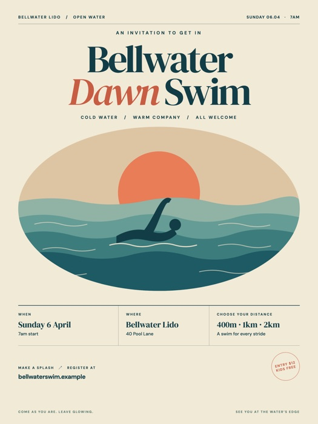
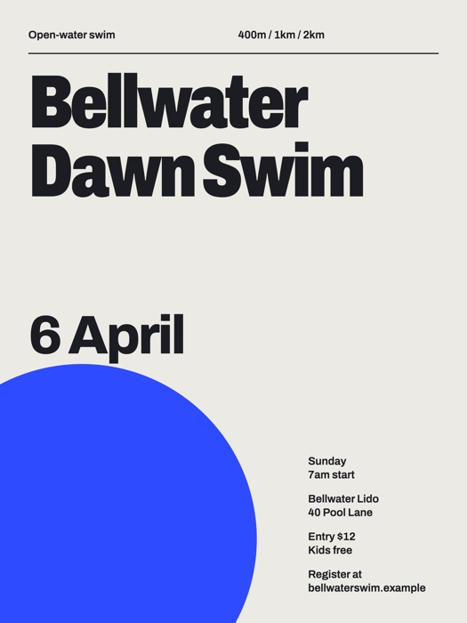
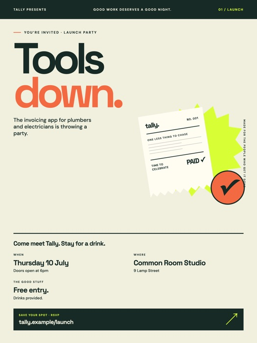
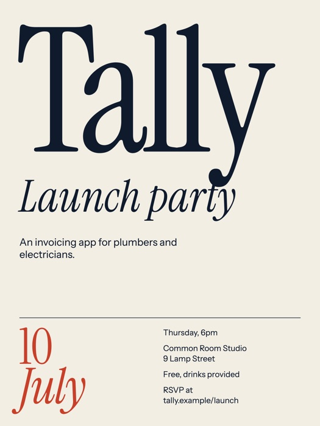
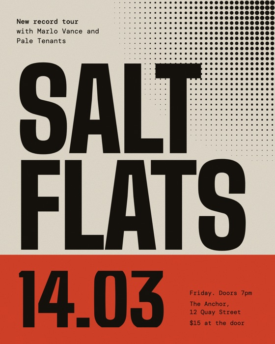
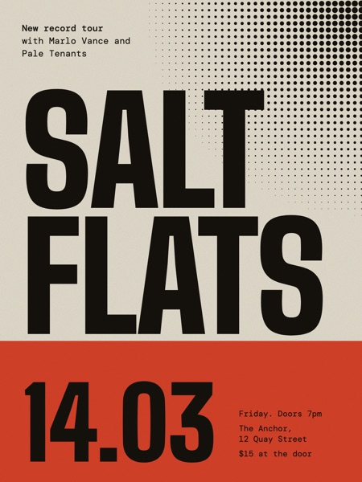
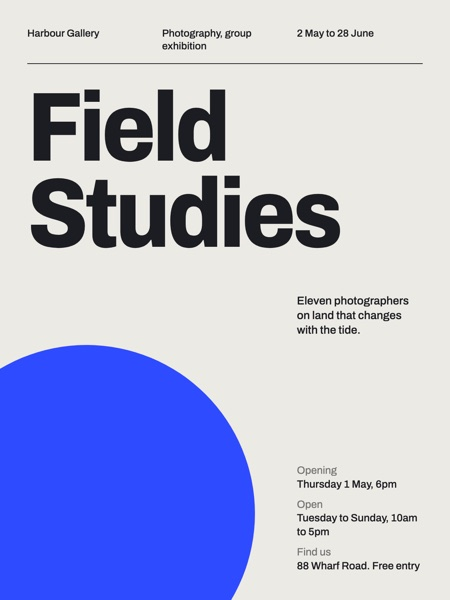
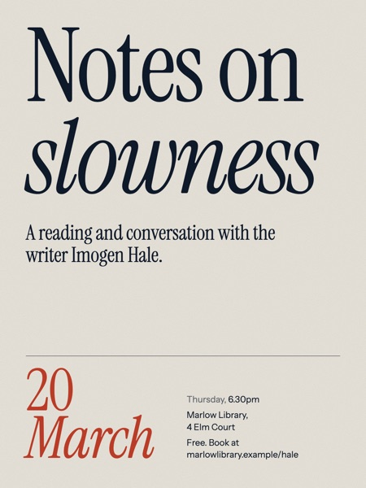
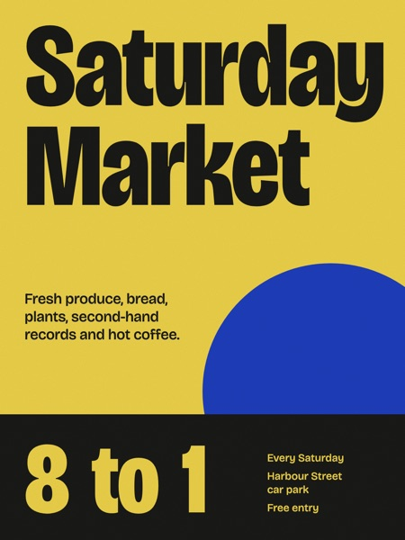

# anti-slop-posters

A pack that makes AI-designed posters look like a person with taste made them.

Posters made by an AI with a plain prompt come out the same every time: centred stack,
gradient glow, tracked-caps "eyebrow" text, an icon or badge, a tagline nobody wrote,
a default font, small type floating in empty space. This pack removes that, in three layers:

1. **Prompts** you paste into any chat (Claude, ChatGPT, Gemini).
2. **A skill** for coding agents (Claude Code, Codex, Cursor, Gemini CLI) that builds the
   poster, renders it, checks it, and makes the agent look at the result.
3. **A Remotion template** to turn the same poster into a short motion clip.

## Before and after

Same model, same brief. Left: the brief alone. Right: with the pack.

| Brief | Without the pack | With the pack |
|---|---|---|
| Open-water swim |  |  |
| App launch party |  |  |

The left side is what you are trying to escape: stamp badge, starburst, check-mark seal,
rotated text, arrows, spaced-out capitals, invented taglines. The right side has one
accent colour, real fonts, hero type that fills the page, and nothing decorative.

The right side is not perfect. In the second poster the tail of the "y" in "Tally" touches
"Launch party". That is why the workflow ends with you looking at the picture.

## Quickstart A: just paste a prompt (any chat, 2 minutes)

1. Open `prompts/00-master-system-prompt.md`. Paste everything below the line into a
   Claude Project, a ChatGPT Project or Custom GPT, a Gemini Gem, or the first message of
   a chat.
2. Attach `skills/poster-design/template/poster.html` and the file in
   `skills/poster-design/template/examples/` closest to what you want.
3. Fill in `prompts/01-brief.md` (or use its 30-second version) and send it.
4. Open the HTML file in a browser. Screenshot it and send the screenshot back with what
   is wrong. The prompt tells the model to fix only what you point at.
5. For a second opinion, paste the poster into a fresh chat with `prompts/02-cold-review.md`.

Other prompts: `03-redesign-existing.md` (fix a poster you already have),
`04-image-generation.md` (photos and illustration without baked-in text),
`05-copy.md` (headlines and copy that do not sound generated).

## Quickstart B: coding agent with the skill (best results)

```bash
git clone https://github.com/ammarshah1n/anti-slop-posters
cd anti-slop-posters
cp -r skills/poster-design ~/.claude/skills/            # Claude Code
cd ~/.claude/skills/poster-design/scripts && npm i && npx playwright install chromium
```

Then ask: "Make a poster for my gig on Friday 14 March at The Anchor." The skill makes the
agent write a seven-line decision block, build from the template, render to PNG/PDF,
run the checker, look at the picture and the 200px thumbnail, and review it with a fresh
context. Other agents: open this repo in the agent; `AGENTS.md` points it at the skill.

The checker (`scripts/render.mjs`) fails on gradients, glow, shadows, emoji and arrow
icons, tracked caps, rotated text, default or system fonts, more than one accent,
text off the poster or clipped, tiny text, low contrast, and big empty bands. It cannot
judge taste or catch letters touching, so the agent must still look.

```bash
node skills/poster-design/scripts/render.mjs posters/gig/poster.html --scale 2 --pdf
```

## Quickstart C: motion (Remotion)

```bash
cd motion && npm i
npm run studio    # preview
npm run still     # out/poster.png
npm run render    # out/poster.mp4
```



One ease for everything, text rising out of masks, a halftone field growing in, an accent
block wiping up. It ends on a finished poster and holds. See `motion/README.md`.

## The examples

All content is fictional. Each one passes the checker with zero warnings.

| Riso gig | Swiss | Editorial | Flat colour | Deliberate slop (the checker flags 17 tells) |
|---|---|---|---|---|
|  |  |  |  |  |

Eight directions are defined in `skills/poster-design/reference/directions.md` (four built
as examples; Night, Heritage, Brutalist and Photo-led are specified with palette and fonts).

## How it works

Slop comes from a model making no decisions. The fix is a small set of hard constraints
and a loop that makes it look at its own work.

- **Decide first.** Direction, one visual idea, composition, palette, fonts, format, where
  the accent goes. Written before any code.
- **Tokens only.** Paper, ink, one accent. One display face, one text face. A real grid.
  No raw colours or sizes outside `:root`.
- **A ban list with replacements** (`reference/slop-list.md`), enforced by the checker.
- **Go big, shape the space.** The hero fills the measure, three levels of hierarchy, one
  structural graphic device, no dead band.
- **Real fonts always loaded.** The most common failure of a "minimal" prompt is a silent
  fall back to a system font.
- **Render, look, then a cold review** by a fresh agent, at most two rounds.

## Honest limits

- **Tested:** the checker and the four examples on macOS (Node 26, Playwright 1.64.0 (pinned),
  Chromium); PDF export; the Remotion still render and a mid-animation frame; two
  before/after briefs.
- **Not tested:** pasting the prompts into the ChatGPT, Claude or Gemini apps (they are
  plain text and should work, but no one has run them there); installing the skill on
  Windows or Linux; `npm run render` to MP4 (only `still` was run); print-ready output
  (no CMYK, bleed is documented, not automated).
- The before/after used one model family (GPT) through a CLI, not every model, and only
  two briefs. Early versions of this pack made posters that were clean but timid and
  half-empty, and one that fell back to system fonts. Those failures are why the rules
  now demand big type, filled space, loaded fonts and a dead-band check. Expect to
  iterate on your own briefs.
- Fonts come from Google Fonts and Fontshare, so the poster needs internet when opened.
- Generated photography is outside this pack; `prompts/04-image-generation.md` covers it.

## Related

For web pages and app UI (not posters), use the open-source
[Nutlope/hallmark](https://github.com/Nutlope/hallmark) skill alongside this one.

## Layout

```
prompts/        paste-anywhere prompts (system, brief, cold review, redesign, images, copy)
skills/poster-design/
  SKILL.md      the workflow for coding agents
  reference/    slop list, type, colour, layout, directions, motion
  template/     starter poster.html + four finished examples + one deliberate slop example
  scripts/      render.mjs: render PNG/PDF/thumbnail and check
motion/         Remotion motion-poster template
AGENTS.md       pointer for coding agents
```

MIT licensed.
